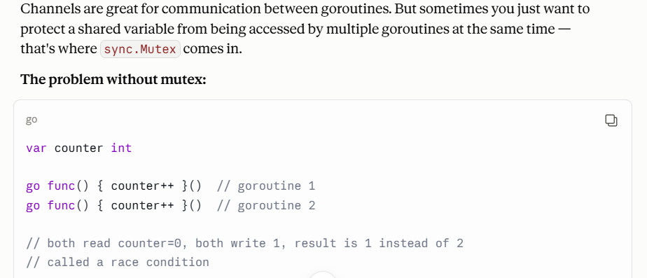
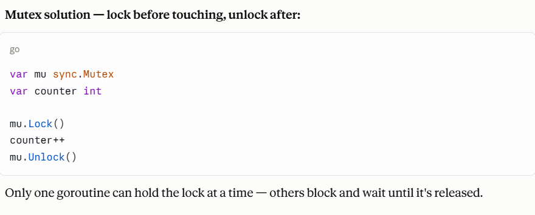
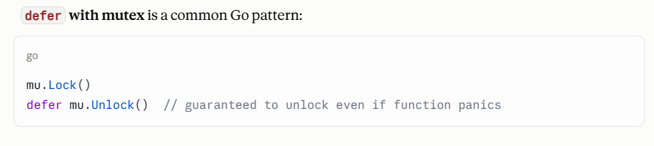

# 1: For loop

- Go has only one looping construct, the for loop.
- for loop has three components separated by semicolons:
    - the init statement: executed before the first iteration
    - the condition expression: evaluated before every iteration
    - the post statement: executed at the end of every iteration

- **Note: Unlike other languages like C, Java, or JavaScript there are no parentheses surrounding the three components of the for statement and the braces { } are always required.**

```bash
package main
import "fmt"
func main(){
	for i := 0; i <= 10; i ++{
		fmt.Println(i)
	}
}
```

- The init and post statements are optional.
```bash
func main() {
	sum := 1
	for ; sum < 1000; {
		sum += sum
	}
	fmt.Println(sum)
}
```

# 2. "While" loop:

- For is Go's "while", you just drop semicolons.
```bash
func main() {
	sum := 1
	for sum < 1000 {
		sum += sum
	}
	fmt.Println(sum)
}
```


# 3. If-else statement:

- Go's if statements are like its for loops; the expression need not be surrounded by parentheses ( ) but the braces { } are required.

- If with a short statement: 
    - Like for, the if statement can start with a short statement to execute before the condition.
    - Variables declared by the statement are only in scope until the end of the if.

```bash
func pow(x, n, lim float64) float64 {
	if v := math.Pow(x, n); v < lim {
		return v
	}
	return lim
}
```

- Variables declared inside an if short statement are also available inside any of the else blocks.

```bash
func pow(x, n, lim float64) float64 {
	if v := math.Pow(x, n); v < lim {
		return v
	} else {
		fmt.Printf("%g >= %g\n", v, lim)
	}
	// can't use v here, though
	return lim
}
```

# 4. Switch statement:
- A switch statement is a shorter way to write a sequence of if - else statements. It runs the first case whose value is equal to the condition expression.
- There are some special features of Go's switch statement:
    - The case expressions need not be constants, and the values involved need not be integers.
    - The break statement is not needed at the end of each case, unlike in C or Java. Execution of cases stops automatically when the first matching case is found.
    - Switch cases evaluate cases from top to bottom, stopping when a case succeeds.
```bash
func main() {
	fmt.Print("Go runs on ")
	switch os := runtime.GOOS; os {
	case "darwin":
		fmt.Println("macOS.")
	case "linux":
		fmt.Println("Linux.")
	default:
		// freebsd, openbsd,
		// plan9, windows...
		fmt.Printf("%s.\n", os)
	}
}
```

- Switch without a condition is the same as switch true. (can be used to implement long if-else logic)
```bash
func main() {
	t := time.Now()
	switch {
	case t.Hour() < 12:
		fmt.Println("Good morning!")
	case t.Hour() < 17:
		fmt.Println("Good afternoon.")
	default:
		fmt.Println("Good evening.")
	}
}
```

# 5. Defer:

- A defer statement defers the execution of a function until the surrounding function returns.


```bash
func main() {
	defer fmt.Println("world")

	fmt.Println("hello")
}
# prints "hello" then "world"
```

- **Stacking defers**: Deferred function calls are pushed onto a stack. When a function returns, its deferred calls are executed in last-in-first-out order.

```bash
func main() {
    fmt.Println("counting")

    for i := 0; i < 10; i++ {
        defer fmt.Println(i)
    }

    fmt.Println("done")
}
```

# 6. sync.Mutex:





```go
type SafeCounter struct {
    mu sync.Mutex
    v  int
}

func (c *SafeCounter) Inc() {
    c.mu.Lock()
    c.v++
    c.mu.Unlock()
}

func (c *SafeCounter) Value() int {
    c.mu.Lock()
    defer c.mu.Unlock()  // defer unlocks when function returns
    return c.v
}

func main() {
    c := SafeCounter{}
    for i := 0; i < 1000; i++ {
        go c.Inc()
    }
    time.Sleep(time.Second)
    fmt.Println(c.Value())  // always 1000
}
```

