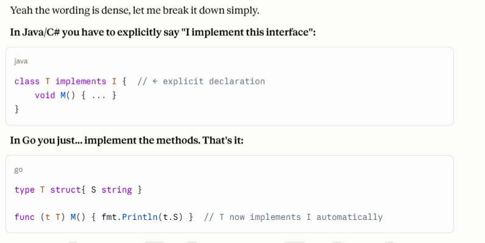
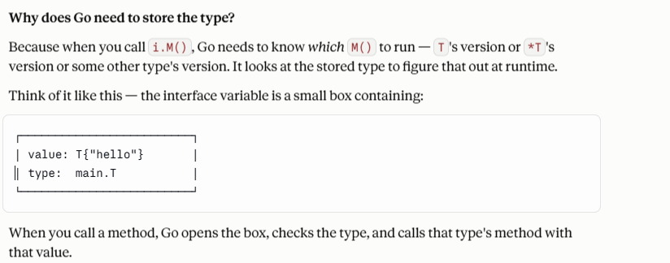
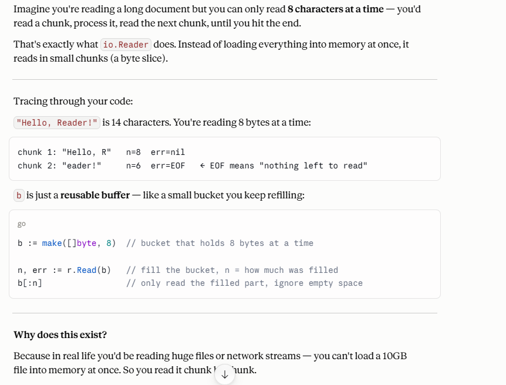

# 1. Methods:

- Go does not have classes. However, you can define methods on types.
- A method is a function with a special receiver argument.
```bash
package main
import "fmt"
import "math"
type Vertex struct {
	X, Y float64
}

func (v Vertex) Abs() float64 {
	return math.Sqrt(v.X*v.X + v.Y*v.Y)
}

func main() {
	v := Vertex{3, 4}
	fmt.Println(v.Abs())
}
```
- You can declare a method on non-struct types, too.
- You can only declare a method with a receiver whose type is defined in the same package as the method. You cannot declare a method with a receiver whose type is defined in another package (which includes the built-in types such as int).
```bash
type MyFloat float64

func (f MyFloat) Abs() float64 {
	if f < 0 {
		return float64(-f)
	}
	return float64(f)
}

func main() {
	f := MyFloat(-math.Sqrt2)
	fmt.Println(f.Abs())
}
```
# 2. Pointer receivers:
- We can declare methods with pointer receivers.
- This means the receiver type has the literal syntax *T for some type T. (Also, T cannot itself be a pointer such as *int.)
```bash
func (v *Vertex) Scale(f float64) {
	v.X = v.X * f
	v.Y = v.Y * f
}
```
# 3. Choosing a value or pointer receiver:
In general, all methods on a given type should have either value or pointer receivers, but not a mixture of both. (We'll see why over the next few pages.)


# 4. Interfaces:
- An interface type is defined as a set of method signatures.
```bash
# Interfaces
// define
type Abser interface {
    Abs() float64
}

// implement (implicit, no "implements" keyword)
type MyFloat float64
func (f MyFloat) Abs() float64 { ... }  // MyFloat implements Abser

// use
var a Abser
a = MyFloat(-1.5)   // ✅

// pointer receiver → only *T satisfies interface, not T
func (v *Vertex) Abs() float64 { ... }
a = &v  // ✅
a = v   // ❌

// value receiver → both T and *T satisfy interface
func (v Vertex) Abs() float64 { ... }
a = v   // ✅
a = &v  // ✅
```

# 5. Interfaces are implemented implicitly:


# 6. Interface values:
- An interface value holds a value of a specific underlying concrete type and that value's type information.


# 7. Type assertions:
```bash
# Type assertions
// get the underlying value out of an interface
t := i.(T)        // panics if i doesn't hold T

// safe version (like map key check)
t, ok := i.(T)    // ok=false if i doesn't hold T, no panic

// mental model: interface is a box, type assertion opens it
var i I = T{"hello"}  // box contains T{"hello"}
t := i.(T)            // take T{"hello"} out of the box
```

# 8. Errors:
```bash
# Errors
// built-in error interface
type error interface {
    Error() string
}

// custom error type
type ErrNegativeSqrt float64

func (e ErrNegativeSqrt) Error() string {
    return fmt.Sprintf("cannot Sqrt negative number: %f", float64(e))
}

// return error
func Sqrt(x float64) (float64, error) {
    if x < 0 {
        return 0, ErrNegativeSqrt(x)  // cast x into custom error type
    }
    return z, nil  // nil = no error
}

// handle error
result, err := Sqrt(-2)
if err != nil {
    fmt.Println(err)  // calls .Error() automatically
}

// fmt.Println on an error calls .Error() same as Stringer calls .String()
```

# 9. Readers:

