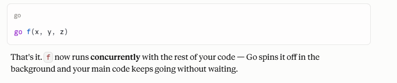
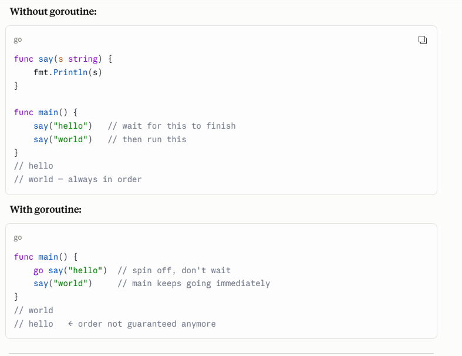
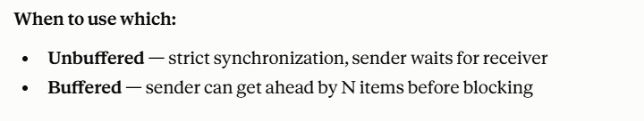
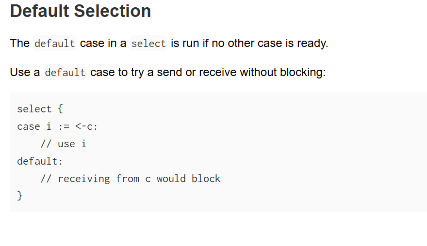

# Introduction to Concurrency in Go:


# 1. Goroutines:

- A goroutine is a lightweight thread managed by Go. You start one with the go keyword:




- Goroutines are very cheap - we can spawn thousands of them, unlike OS threads.
- They share the same address space.
- The order of execution of goroutines is not guaranteed, which can lead to race conditions if multiple goroutines access shared data without proper synchronization.
- If main() finishes, all goroutines die regardless of whether they're done.

--> That's why we need channels to coordinate and wait.

# 2. Channels:

- A channel is a pipe that goroutines use to send and receive data:
```go
ch := make(chan int)  // create a channel carrying ints

ch <- 42    // send into channel
v := <-ch   // receive from channel
```

**Channels block:**
- Sending blocks until someone receives
- Receiving blocks until someone sends

```go
func sum(s []int, ch chan int) {
    total := 0
    for _, v := range s {
        total += v
    }
    ch <- total  // send result when done
}

func main() {
    ch := make(chan int)
    go sum([]int{1, 2, 3, 4, 5}, ch)
    result := <-ch  // main BLOCKS here, waiting for goroutine
    fmt.Println(result)  // 15
}
```

# 3. Buffered Channels:

- Regular channels block immediately if no one is ready to receive. Buffered channels have a queue — you can send multiple values without a receiver being ready yet:
```go
ch := make(chan int, 2)  // create a buffered channel with capacity 2
ch <- 1  // send into channel
ch <- 2  // send into channel
// ch <- 3  // would block here, because buffer is full
```


# 4. Range and Close:
A sender can **close** a channel to signal "no more values coming":

```go
close(ch)
```

A receiver can check if a channel is closed:
```go
v, ok := <-ch
// ok = false means channel is closed and empty
```

---

## Range over a channel

Cleaner than checking ok manually — range stops automatically when channel is closed:

```go
func fibonacci(n int, ch chan int) {
    x, y := 0, 1
    for i := 0; i < n; i++ {
        ch <- x
        x, y = y, x+y
    }
    close(ch)  // done sending, close the channel
}

func main() {
    ch := make(chan int, 10)
    go fibonacci(10, ch)

    for v := range ch {  // keeps receiving until channel is closed
        fmt.Println(v)
    }
}
```

---

## Rules

- Only the **sender** should close a channel, never the receiver
- Sending to a closed channel causes a **panic**
- You don't have to close channels — only close when the receiver needs to know "we're done"
---

## Mental model

```
goroutine sends values ──→ ch ──→ range receives
goroutine calls close() ──→ ch ──→ range stops automatically
```

Like a conveyor belt — worker puts items on it, hits stop when done, receiver stops when belt stops.

# 5. Select:

- The select statement lets a goroutine wait on multiple communication operations.
- A select blocks until one of its cases can run, then it executes that case. It chooses one at random if multiple are ready.
```go
package main

import "fmt"

func fibonacci(c, quit chan int) {
	x, y := 0, 1
	for {
		select {
		case c <- x:
			x, y = y, x+y
		case <-quit:
			fmt.Println("quit")
			return
		}
	}
}

func main() {
	c := make(chan int)
	quit := make(chan int)
	go func() {
		for i := 0; i < 10; i++ {
			fmt.Println(<-c)
		}
		quit <- 0
	}()
	fibonacci(c, quit)
}

```



